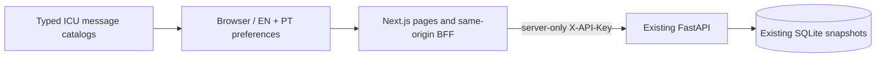
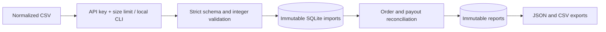

# Architecture and decisions

[Português (Brasil)](ARCHITECTURE.pt-BR.md)

Status: working local service; operational hardening remains in progress.

## Dashboard and internationalization — 2026-10-22

The existing reconciliation engine, SQLite schema and FastAPI contracts are
unchanged. `frontend/` adds Next.js 16.4.2 App Router, React 19.3.1 and strict
TypeScript. Dependency versions are pinned and `package-lock.json` is committed.
Tailwind 4 provides design tokens; checked-in shadcn/ui components use Radix
primitives. Geist is self-hosted. Lucide, Recharts, TanStack Table 8, TanStack
Query, React Hook Form and Zod cover icons, charts, tables, server state and forms.
TanStack Table stays on the tested v8 API; v9 has incompatible imports.

The BFF forwards only the existing supported endpoints to a validated loopback
HTTP origin, refuses redirects and cross-origin mutations, caps streamed CSV
bodies at 2 MiB and applies a 30-second upstream timeout. No CORS grant is needed.
Connection settings hold credentials in bounded server memory, behind opaque
eight-hour HttpOnly/SameSite cookies; environment configuration is the fallback.
Demo imports use the actual example bytes and normal API calls. Only reports
whose three source hashes match those files receive the sample banner.

`next-intl` 4 provides ICU rendering and typed translation keys without localized
routes or redirect middleware. The server resolves the preference cookie or
`Accept-Language` once for initial HTML. A client provider updates locale and
the preference cookie immediately; it does not remount forms or invalidate
queries. Both small catalogs ship to support switching without a network trip.
Validation stores message codes, backend diagnostics map to descriptors, and
toast content consumes the active locale at render time. Unknown errors use a
localized safe fallback. The two catalogs share a TypeScript shape; tests compare
keys, ICU parameters and render every message.

Money is formatted from integer minor units using BigInt parts and `Intl`, with
JPY's zero decimal places. No FX conversion, financial aggregation across
currencies or modification of stored/exported report values occurs. Dates are
locale-specific with explicit UTC. Metadata lists are fetched in API pages of
100; full report filtering/sorting/pagination happens in the browser. Large
histories and reports need future server-side filtering and capacity work.

Technical references (accessed 2026-10-22):
[Next.js installation](https://nextjs.org/docs/app/getting-started/installation),
[shadcn/ui Tailwind 4](https://ui.shadcn.com/docs/tailwind-v4),
[next-intl configuration](https://next-intl.dev/docs/usage/configuration), and
[next-intl TypeScript integration](https://next-intl.dev/docs/workflows/typescript).
The choice of cookie preferences without locale URLs is a local product decision.

1. **Explicit source snapshots.** Each run selects three imports. This prevents
   accidental reconciliation against an ever-changing global dataset. The
   operator must align the settlement window; no automatic date selection.
2. **Exact integer money.** Charge and refund totals are compared separately.
   Errors cannot cancel each other merely because net values agree. Currency
   totals remain separate. There is no conversion or rounding tolerance.
3. **SQLite and standard-library SQL.** A local pilot needs no external service.
   `BEGIN IMMEDIATE` serializes writes; unique keys enforce import/run replay
   safety. WAL allows readers during a writer. This is a single-host choice;
   PostgreSQL and measured capacity planning are needed before multi-host scale.
4. **Atomic, immutable records.** Parsing happens before the write transaction.
   Imports and reports commit completely or roll back. Database triggers reject
   updates/deletes through normal SQL, but a database administrator could remove
   those triggers. This is audit provenance, not cryptographic tamper-proofing.
5. **Versioned, deterministic rules.** Run fingerprints include the rule version
   and selected import IDs. Each report stores raw-source SHA-256 hashes,
   import timestamps, selected IDs, transaction references and computed results.
   The original raw CSV bytes are not retained; source owners must archive them.
6. **Bounded synchronous work.** At most 10,000 rows per import, 2 MiB HTTP input.
   Database work runs in FastAPI's worker threads. Reports are stored as JSON
   snapshots, trading query flexibility for simple reproducibility.
7. **One trusted operator boundary.** API-key authentication uses constant-time
   comparison. There are no user accounts or tenant boundaries. The local CLI
   relies on the operating system's database access controls.

Business value is a hypothesis: help finance operators focus on discrepancies
instead of comparing exports manually. [Stripe's reconciliation documentation](https://docs.stripe.com/reports/payout-reconciliation)
establishes the underlying payout/batch workflow (accessed 2026-10-20; no reliable
publication date shown). ClearLedger uses its own normalized schema and is not
a Stripe integration.

Validation covers races, replays, conflicting imports, invalid rows, rollback,
restart persistence and HTTP/CLI behavior. No throughput SLA, production
deployment, cloud integration, savings measurement or formal audit is claimed.
