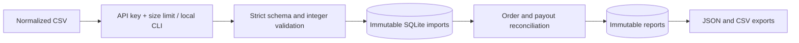

# Architecture and decisions

[Português (Brasil)](ARCHITECTURE.pt-BR.md)

Status: working local service; operational hardening remains in progress.

1. **Explicit source snapshots.** Each run selects three imports. This prevents
   accidental reconciliation against an ever-changing global dataset. The
   operator must align the settlement window; no automatic date selection.
2. **Exact integer money.** Charge and refund totals are compared separately.
   Errors cannot cancel each other merely because net values agree. Currency
   totals remain separate. There is no conversion or rounding tolerance.
3. **SQLite and standard-library SQL.** A local pilot needs no external service.
   `BEGIN IMMEDIATE` serializes writes; unique keys enforce import/run replay
   safety. WAL allows readers during a writer. This is a single-host choice;
   PostgreSQL and measured capacity planning are needed before multi-host scale.
4. **Atomic, immutable records.** Parsing happens before the write transaction.
   Imports and reports commit completely or roll back. Database triggers reject
   updates/deletes through normal SQL, but a database administrator could remove
   those triggers. This is audit provenance, not cryptographic tamper-proofing.
5. **Versioned, deterministic rules.** Run fingerprints include the rule version
   and selected import IDs. Each report stores raw-source SHA-256 hashes,
   import timestamps, selected IDs, transaction references and computed results.
   The original raw CSV bytes are not retained; source owners must archive them.
6. **Bounded synchronous work.** At most 10,000 rows per import, 2 MiB HTTP input.
   Database work runs in FastAPI's worker threads. Reports are stored as JSON
   snapshots, trading query flexibility for simple reproducibility.
7. **One trusted operator boundary.** API-key authentication uses constant-time
   comparison. There are no user accounts or tenant boundaries. The local CLI
   relies on the operating system's database access controls.

Business value is a hypothesis: help finance operators focus on discrepancies
instead of comparing exports manually. [Stripe's reconciliation documentation](https://docs.stripe.com/reports/payout-reconciliation)
establishes the underlying payout/batch workflow (accessed 2026-10-20; no reliable
publication date shown). ClearLedger uses its own normalized schema and is not
a Stripe integration.

Validation covers races, replays, conflicting imports, invalid rows, rollback,
restart persistence and HTTP/CLI behavior. No throughput SLA, production
deployment, cloud integration, savings measurement or formal audit is claimed.
